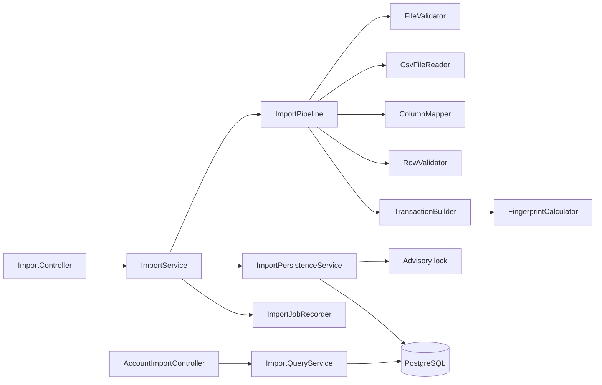

# Requirements

### Overview & Goals
Permettre à un utilisateur Eparly authentifié d'importer un relevé bancaire CSV dans l'un de ses comptes : prévisualisation sans écriture, validation, import atomique, déduplication, historique consultable. Backend uniquement (`services/api`, package `com.eparly.api.imports`). Aucune modification de `apps/mobile`, ni des migrations V1–V7.

### Scope
**In scope**
- `POST /v1/imports/preview`, `POST /v1/imports`, `GET /v1/imports`, `GET /v1/imports/{id}`, `GET /v1/accounts/{accountId}/imports`.
- Lecture CSV (UTF-8, UTF-8 BOM, Windows-1252, ISO-8859-1 ; `;` et `,` ; champs cités, retours à la ligne dans les champs).
- Mapping dynamique des colonnes, corrigeable par l'utilisateur, avec point d'extension pour de futurs profils bancaires.
- Normalisation des montants (BigDecimal -> centimes `long`) et des dates (`LocalDate`).
- Déduplication déterministe, migration additive V8 (intégrité + unicité `source_uid`).
- Limites de fichier configurables, erreurs HTTP standardisées, OpenAPI avec exemples JSON, documentation pour l'étape 7C.

**Out of scope**
- Open Banking, catégorisation IA (7C), stockage durable des fichiers bruts, file de messages, microservices, toute modification de `apps/mobile`.

### User Stories
- En tant qu'utilisateur, je charge mon CSV et je vois les colonnes détectées, un mapping proposé, un échantillon de transactions, et les erreurs/avertissements avec numéros de ligne avant de valider.
- En tant qu'utilisateur, je corrige le mapping ou l'encodage puis je confirme l'import.
- En tant qu'utilisateur, je réimporte un relevé qui chevauche le précédent sans créer de doublons, mais sans perdre deux achats légitimes identiques.
- En tant qu'utilisateur, je consulte l'historique de mes imports (paginé).
- En tant que développeur mobile, j'ai un contrat OpenAPI clair (multipart, mapping, rapport).

### Functional Requirements
1. **Preview** (multipart : `accountId`, `file`, `mapping?`, `charset?`, `delimiter?`) : JWT obligatoire, utilisateur ACTIF, compte appartenant à l'utilisateur (sinon **404 neutre**), validation du fichier, détection encodage/séparateur/colonnes, mapping proposé, analyse **complète** du fichier (bornée à 10 000 lignes) pour les erreurs, échantillon des 20 premières lignes valides, SHA-256 du fichier, estimation lecture seule `wouldInsert/wouldSkip`. **Aucune écriture** en base.
2. **Import** (multipart : `accountId`, `file`, `mapping` obligatoire, `fileHash` obligatoire, `charset`/`delimiter`) : le serveur recalcule le SHA-256 (409 si différent), reparse et revalide tout lui-même, ne fait confiance à aucun montant/transaction client. Atomicité : une erreur bloquante => **aucune transaction** persistée, réponse 422 avec rapport corrigeable, et un `ImportJob` `FAILED` est tracé (compteurs + résumé non sensible).
3. **Encodage** : BOM -> UTF-8 ; sinon décodage UTF-8 strict ; sinon repli vers 8 bits avec avertissement `CHARSET_AMBIGUOUS` + candidats (`WINDOWS_1252`, `ISO_8859_1`). L'import exige un `charset` explicite quand la preview a signalé l'ambiguïté (400 `CHARSET_REQUIRED`).
4. **Montants** : `-45,50`->-4550 ; `1250,00`->125000 ; `1 250,00` (espaces, NBSP, espace fine)->125000 ; `1 250.00` accepté ; `+350,20`->35020 ; symboles `€`/`EUR` uniquement s'ils correspondent à la devise du compte. Colonne signée **ou** Débit/Crédit (les deux remplis ou aucun -> erreur). Rejet : valeur ambiguë (`1,250` sans format explicite), décimales > devise, dépassement `long`, texte non numérique. Montant nul : avertissement. Un montant positif n'est **jamais** déduit comme revenu.
5. **Dates** : `dd/MM/yyyy`, `dd-MM-yyyy`, `dd.MM.yyyy`, `yyyy-MM-dd`, ou pattern explicite d'une liste blanche (dont `MM/dd/yyyy` uniquement si demandé). Résolution stricte. En AUTO, seuls les formats jour-premier sont essayés ; le format détecté est renvoyé et doit être explicite dans le mapping envoyé à l'import (pas d'inversion silencieuse). `bookingDate` obligatoire (jamais inventée), `valueDate` optionnelle et distincte.
6. **Mapping** : `dateColumn`, `valueDateColumn?`, `labelColumn`, `amountColumn` **ou** `debitColumn`+`creditColumn`, `currencyColumn?`, `sourceIdColumn?`, `dateFormat`, `amountFormat` (`AUTO|FR|EN`). Colonnes référencées par nom d'en-tête (insensible à la casse/accents), colonnes inconnues ignorées, lignes vides ignorées, espaces nettoyés.
7. **Historique** : listes paginées (`page`, `size` plafonné à 100, tri `createdAt` desc) et détail, uniquement pour l'utilisateur courant ; DTO `id, accountId, status, totalRows, insertedRows, skippedRows, failedRows, createdAt, completedAt, errorSummary`.
8. **Déduplication** : voir Technical Design. Réimporter le même fichier -> job `COMPLETED`, `insertedRows=0`, `skippedRows=N`.

### Non-Functional Requirements
- Limites configurables : 5 Mo, 10 000 transactions, timeout de traitement, 50 colonnes max, taille de champ bornée.
- Aucun fichier brut conservé ; aucun libellé/montant dans les logs ; aucune stack trace ni chemin dans les réponses.
- 62 tests existants conservés.

# Technical Design

### Current Implementation
- Domaine 7A déjà présent : `Account`, `ImportJob` (`markCompleted/markFailed`, statuts PENDING/PROCESSING/COMPLETED/FAILED), `Transaction` (BIGINT `amountMinor`, `fingerprint`, `sourceUid`, `rawLabel`, `normalizedLabel`, `transactionType`), `Category`, et leurs repositories.
- V7 : `UNIQUE(account_id, fingerprint)`. **Lacunes constatées** : rien n'impose `import_jobs.user_id = accounts.user_id`, ni `transactions.account_id = import_jobs.account_id`, ni la visibilité d'une catégorie privée ; `source_uid` n'est pas unique ; `Transaction.toString()` inclut le libellé (risque de fuite en logs).
- `ImportJobRepository`/`TransactionRepository` contiennent des méthodes non filtrées par utilisateur (`findAllByAccountId...`, `findByAccountIdAndFileHash`, `findWithCategoryById`) : elles ne seront pas utilisées sans contrôle de propriété préalable. `AccountRepository.findByIdAndUserId` et `CategoryRepository.findVisibleCategoriesForUser` sont corrects.
- `SecurityConfiguration` : `anyRequest().authenticated()` + validation du statut utilisateur via `UserSecurityValidator` -> `/v1/imports/**` est déjà protégé ; l'identité vient de `@AuthenticationPrincipal Jwt` (`jwt.getSubject()` -> UUID, cf. `MeController`).
- Erreurs : `ApiException(HttpStatus, message)` + `ApiExceptionHandler` -> `ApiErrorResponse(timestamp,status,error,message,path)`. Jackson = `tools.jackson`. Pas de dépendance CSV dans `pom.xml`, pas de limite multipart.
- Tests : `@SpringBootTest @AutoConfigureMockMvc @Testcontainers @ActiveProfiles("test")` avec `postgres:17-alpine`, `TestJwtConfiguration` ; `PostgresIntegrationTest` vérifie V1–V7.

### Key Decisions
1. **Pipeline partagé sans état** (choisi) : preview et import appellent le même `ImportPipeline` (lecture -> mapping -> validation -> construction), seule la persistance diffère -> résultats identiques.
2. **Déduplication** (choisie) : `source_uid` fiable => identité propre ; sinon fingerprint avec **numéro d'occurrence** dans le fichier.
3. **Concurrence** (choisie) : `pg_advisory_xact_lock` par compte + `INSERT ... ON CONFLICT DO NOTHING` natif comme filet.
4. **Atomicité** : tout ou rien ; un job `FAILED` est enregistré dans une transaction séparée (`REQUIRES_NEW`) pour l'historique.
5. **Mapping par nom d'en-tête**, `mapping` envoyé comme champ texte JSON dans le multipart (simple pour React Native `FormData`).
6. **Bibliothèque** : Apache Commons CSV (dernière 1.14.x stable, version vérifiée à l'implémentation) ; fichier lu en mémoire (<= 5 Mo) -> pas de ressources non bornées.
7. **Type de transaction** : négatif -> `EXPENSE`, positif -> `UNKNOWN` (ni `INCOME` ni `REFUND` déduits) ; la qualification est repoussée à 7C.
8. **Extensibilité** : interface `BankProfile` (`Optional<ImportMapping> match(headers)`) ; implémentation par défaut `GenericHeaderProfile` basée sur un dictionnaire de synonymes d'en-têtes (date, libellé, montant, débit, crédit...), sans noms de banques. Les profils sont des beans Spring ordonnés.

### Architecture Diagram


### Proposed Changes
**Structure du package** `com.eparly.api.imports` (domain/repository existants conservés) :
- `api` : `ImportController` (`/v1/imports`, `/preview`, `/{id}`), `AccountImportController` (`/v1/accounts/{accountId}/imports`), `ImportExceptionHandler` (rapport 422 + exceptions du package).
- `dto` : `ImportPreviewResponse`, `ImportResultResponse`, `ImportJobResponse`, `PageResponse<T>`, `ImportMappingDto`, `ImportIssueDto`, `ImportRejectedResponse`.
- `service` : `ImportService` (orchestration + autorisation), `ImportPipeline`, `ImportPersistenceService`, `ImportJobRecorder`, `ImportQueryService`, `FingerprintCalculator`, `ImportProperties`.
- `parser` : `CsvFileReader`, `CharsetDetector`, `DelimiterDetector`, `AmountParser`, `DateParser`, `ParsedCsv`.
- `mapper` : `ColumnMapper`, `BankProfile`, `GenericHeaderProfile`, `ImportMapping`.
- `validation` : `FileValidator`, `RowValidator`, `ImportIssue` (ligne, colonne, code, message, sévérité).

**Sécurité d'accès** : `ImportService` résout l'utilisateur depuis le JWT (jamais depuis le client), vérifie `ACTIVE`, charge le compte via `accountRepository.findByIdAndUserId` (sinon `ApiException(404, "Account not found")`), lit un job via `findByIdAndUserId` (404 sinon). Les nouvelles requêtes de listing sont paginées et filtrées par `userId` (`Page<ImportJob> findByUserId`, `findByAccountIdAndUserId`).

**Fichier** (`FileValidator`) : taille réelle, non vide, pas d'octet NUL, signatures binaires refusées (ZIP/PDF/etc.), au moins un en-tête de >= 2 colonnes et une ligne de données ; l'extension et le `Content-Type` ne sont pas des preuves. Délai de traitement vérifié dans la boucle (`eparly.imports.processing-timeout`), limite de lignes et de colonnes. Erreurs listées plafonnées (100) avec `issueCount`/`truncated`.

**Déduplication** (`FingerprintCalculator`, version `v1` documentée) :
- Avec `source_uid` non vide : `fingerprint = SHA-256("v1|uid|" + sourceUid)`, `source_uid` renseigné. Un `source_uid` répété dans un même fichier est une erreur bloquante (non fiable).
- Sinon : `base = bookingDate|amountMinor|currency|normalizedLabel`, `fingerprint = SHA-256("v1|" + base + "|" + n)` où `n` est le rang d'occurrence de `base` dans le fichier. Indépendant de l'ordre des lignes (les lignes identiques sont interchangeables), indépendant du numéro de ligne ; `valueDate` exclue car elle varie entre exports.
- Conséquences : réimport identique -> tout ignoré ; deux achats identiques légitimes -> `n=1,2` coexistent ; relevés chevauchants -> les opérations communes ont les mêmes `(base,n)`.
- **Limites documentées** : si un relevé B contient plus d'occurrences identiques que A, les surnuméraires sont insérés (et peuvent être de vrais doublons) ; mélange d'exports avec/sans `source_uid` => doublons possibles ; libellés modifiés par la banque entre deux exports => non reconnus ; ambiguïtés signalées en avertissement `AMBIGUOUS_IDENTICAL_ROWS` avec leur nombre.

**Persistance** (`ImportPersistenceService`, une transaction) : (1) `select pg_advisory_xact_lock(hashtextextended(:accountId, 0))` ; (2) création de l'`ImportJob` `PROCESSING` (user et account issus de l'entité autorisée) ; (3) insertion native `INSERT ... ON CONFLICT DO NOTHING` (couvre `uq_transactions_account_fingerprint` et l'index partiel `source_uid`), le nombre de lignes affectées donne `inserted`, le reste `skipped` ; (4) `markCompleted(total, inserted, skipped, 0)`. Les catégories ne sont pas affectées à l'import (`category_id` NULL).

**Erreurs HTTP** : 400 requête/paramètre/mapping invalide ou `CHARSET_REQUIRED`, 401 sans JWT, 403 compte inactif, 404 compte/import inconnu ou d'un autre utilisateur, 409 hash incohérent, 413 fichier trop gros, 415 fichier non CSV, 422 erreurs bloquantes (corps `ImportRejectedResponse` avec `importJobId` et liste d'`ImportIssueDto`), 500 générique sans détail. Ajouts à `ApiExceptionHandler` (global, car l'erreur multipart survient avant le contrôleur) : `MaxUploadSizeExceededException`->413, `MissingServletRequestPart/Parameter`, `MethodArgumentTypeMismatch`, `ConstraintViolation`->400.

**Configuration** : `eparly.imports.max-file-bytes=5242880`, `max-rows=10000`, `max-columns=50`, `processing-timeout=PT30S`, `preview-sample-size=20` ; `spring.servlet.multipart.max-file-size=5MB`, `max-request-size=6MB`. `ImportProperties` suit le pattern de `AuthPropertiesConfiguration`.

**Logs** : seuls ids, compteurs et codes sont journalisés ; `Transaction.toString()` est expurgé du libellé.

### Data Models / Contracts
**Migration `V8__import_integrity.sql`** (additive) :
```sql
ALTER TABLE accounts ADD CONSTRAINT uq_accounts_id_user UNIQUE (id, user_id);
ALTER TABLE import_jobs ADD CONSTRAINT fk_import_jobs_account_owner
  FOREIGN KEY (account_id, user_id) REFERENCES accounts (id, user_id);
ALTER TABLE import_jobs ADD CONSTRAINT uq_import_jobs_id_account UNIQUE (id, account_id);
ALTER TABLE transactions ADD CONSTRAINT fk_transactions_job_account
  FOREIGN KEY (import_job_id, account_id) REFERENCES import_jobs (id, account_id);
CREATE UNIQUE INDEX uq_transactions_account_source_uid
  ON transactions (account_id, source_uid) WHERE source_uid IS NOT NULL;
ALTER TABLE import_jobs ADD CONSTRAINT chk_import_jobs_row_sum
  CHECK (inserted_rows + skipped_rows + failed_rows <= total_rows);
-- trigger: category_id doit etre systeme ou appartenir au proprietaire du compte
```
Le trigger `BEFORE INSERT OR UPDATE OF category_id, account_id ON transactions` vérifie que la catégorie est système ou que `categories.user_id = accounts.user_id`. Les FK existantes `ON DELETE RESTRICT` sont conservées ; Hibernate `ddl-auto=validate` n'est pas affecté.

**Mapping (JSON dans le champ multipart `mapping`)** :
```json
{"dateColumn":"Date operation","valueDateColumn":"Date valeur","labelColumn":"Libelle",
 "amountColumn":"Montant","debitColumn":null,"creditColumn":null,
 "currencyColumn":null,"sourceIdColumn":null,
 "dateFormat":"dd/MM/yyyy","amountFormat":"FR"}
```
**Preview (200)** :
```json
{"fileHash":"9f86d0...","detectedCharset":"UTF_8","charsetAmbiguous":false,
 "charsetCandidates":[],"detectedDelimiter":";","headers":["Date operation","Libelle","Montant"],
 "suggestedMapping":{},"mappingComplete":true,"totalRows":120,
 "wouldInsert":118,"wouldSkip":2,"blocking":false,
 "sample":[{"line":2,"bookingDate":"2025-03-04","amountMinor":-4550,"currency":"EUR","label":"PAIEMENT CB EXEMPLE"}],
 "errors":[{"line":14,"column":"Montant","code":"INVALID_AMOUNT","message":"Montant non reconnu"}],
 "warnings":[{"line":9,"code":"AMBIGUOUS_IDENTICAL_ROWS","message":"2 lignes identiques"}],
 "issueCount":2,"truncated":false}
```
**Import (201)** : `{"importJob":{id,accountId,status,totalRows,insertedRows,skippedRows,failedRows,createdAt,completedAt,errorSummary},"warnings":[...]}`. **422** : `{timestamp,status,error,message,path,importJobId,errors[],issueCount,truncated}`. **Page** : `{content[],page,size,totalElements,totalPages}`.

### File Structure
- `services/api/pom.xml` (commons-csv) ; `application.properties` (+ `application-test.properties` si besoin) ; `db/migration/V8__import_integrity.sql`.
- `imports/{api,dto,service,parser,mapper,validation}/...` (nouveaux fichiers listés ci-dessus).
- Modifiés : `ImportJobRepository` (méthodes paginées), `ApiExceptionHandler`, `Transaction.toString()`, `PostgresIntegrationTest` (V8).
- Nouveau : `services/api/docs/imports-api.md` (contrat, exemples, limites 7C).

### Risks
- Les tests existants (`FinancialDomainIntegrationTest`) peuvent créer des jobs/transactions incohérents que V8 rejettera : les ajuster seulement si la donnée de test est réellement incohérente, sans affaiblir V8.
- Handler d'erreurs générique : ne pas transformer les erreurs Spring MVC (404 route, 405) en 500 ; le repli délègue les `ErrorResponse`.
- Encodage Windows-1252 vs ISO-8859-1 indiscernables : choix explicite exigé à l'import.
- Imports de 10 000 lignes : insertion par lots dans une transaction, timeout vérifié ; le verrou advisory sérialise les imports d'un même compte (acceptable pour le MVP).

# Testing

### Validation Approach
Tests unitaires purs pour parseurs/mapping/fingerprint, tests d'intégration `@SpringBootTest` + MockMvc + Testcontainers `postgres:17-alpine` pour les parcours HTTP, avec un utilisateur actif et un JWT réel obtenu comme dans `AuthIntegrationTest`. Les 62 tests existants doivent rester verts.

### Key Scenarios
- Parsing : UTF-8, UTF-8 BOM, `;`, `,`, champs cités avec séparateur et retour ligne, Windows-1252, colonnes dans un autre ordre, lignes vides, colonnes inconnues.
- Mapping automatique (synonymes français) et mapping personnalisé ; débit/crédit.
- Montants FR (`-45,50`, `1 250,00`, `1 250.00`, `+350,20`) ; dates françaises/ISO.
- Preview : réponse correcte + **aucune ligne** créée dans `transactions`/`import_jobs`.
- Import : persistance, compteurs, `ImportJob` COMPLETED ; hash incohérent -> 409.
- Réimport du même fichier -> 0 inséré ; deux achats identiques légitimes coexistent ; fichiers chevauchants A/B, relevé réordonné ; `source_uid` fiable.
- Isolation : import dans le compte d'un autre -> 404, sans JWT -> 401, historique/détail d'un autre utilisateur -> 404/absents.
- Intégrité V8 (JDBC direct) : job avec compte d'un autre utilisateur rejeté, transaction avec compte différent du job rejetée, catégorie privée d'un autre utilisateur rejetée, `source_uid` dupliqué rejeté.
- Concurrence : deux (puis plusieurs) imports simultanés du même fichier -> total transactions = N, `inserted` cumulé = N.
- Historique : pagination, plafond de `size`, `createdAt` desc.
- Logs : capture de logs pendant import avec un libellé marqueur -> absent.

### Edge Cases
Dates invalides (`31/02/2025`, ambiguës), montants invalides/ambigus/dépassement `long`/trop de décimales, fichier vide, fichier > 5 Mo (413), fichier binaire renommé `.csv` (415), > 10 000 lignes (422), `source_uid` dupliqué dans le fichier, débit et crédit tous deux remplis, charset ambigu sans choix (400), erreurs bloquantes -> aucune insertion partielle mais job FAILED tracé, erreurs HTTP au format `ApiErrorResponse` sans stack trace.

### Test Changes
- Nouveaux : `CsvFileReaderTest`, `AmountParserTest`, `DateParserTest`, `ColumnMapperTest`, `FingerprintCalculatorTest`, `ImportApiIntegrationTest`, `ImportDeduplicationIntegrationTest`, `ImportConcurrencyIntegrationTest`, `ImportIntegrityMigrationTest`.
- Modifié : `PostgresIntegrationTest` (vérifie aussi V8).
- Vérifications finales réelles : `mvnw verify`, Flyway/Hibernate validate, démarrage local contre PostgreSQL (sans supprimer volumes Docker), parcours curl preview/import avec JWT valide, refus sans JWT, refus compte d'un autre utilisateur, Actuator `/actuator/health`.

# Delivery Steps

### ✓ Step 1: Add V8 integrity migration, CSV dependency, import configuration and history repository queries
La base impose l'intégrité utilisateur/compte/job/transaction/catégorie, et le projet compile avec Commons CSV et les limites configurables.

- Créer `V8__import_integrity.sql` : unicité `(id,user_id)` sur `accounts`, FK composite `import_jobs(account_id,user_id)`, unicité `(id,account_id)` sur `import_jobs`, FK composite `transactions(import_job_id,account_id)`, index unique partiel `(account_id,source_uid)`, CHECK de cohérence des compteurs, trigger de visibilité des catégories. Ne toucher à aucune migration V1–V7.
- Ajouter `commons-csv` (1.14.x stable) dans `pom.xml`.
- Ajouter les propriétés `eparly.imports.*` et `spring.servlet.multipart.*` dans `application.properties`, avec `ImportProperties` (pattern `AuthPropertiesConfiguration`).
- Ajouter à `ImportJobRepository` des méthodes paginées filtrées par utilisateur (`findByUserId`, `findByAccountIdAndUserId`).
- Expurger le libellé de `Transaction.toString()`.
- Mettre à jour `PostgresIntegrationTest` pour V8 et ajouter `ImportIntegrityMigrationTest` ; lancer les tests financiers existants pour détecter toute donnée de test incohérente.

### ✓ Step 2: Implement CSV reading, column mapping, amount/date normalization and row validation
Un fichier CSV brut est transformé en lignes validées (montants en centimes, dates `LocalDate`) avec erreurs et avertissements numérotés, sans dépendre de Spring.

- `parser` : `CharsetDetector` (BOM, UTF-8 strict, candidats 8 bits), `DelimiterDetector` (`;`/`,`), `CsvFileReader` (Commons CSV, champs cités, lignes vides, nettoyage des espaces, limites lignes/colonnes/timeout), `AmountParser` (BigDecimal, formats FR/EN/AUTO, rejet des ambiguïtés, `longValueExact`, décimales selon la devise), `DateParser` (liste blanche, résolution stricte, format détecté).
- `mapper` : `ImportMapping`, `ColumnMapper`, interface `BankProfile` et `GenericHeaderProfile` (synonymes d'en-têtes insensibles aux accents).
- `validation` : `FileValidator` (taille, vide, binaire, structure minimale), `RowValidator`, `ImportIssue`.
- Tests unitaires : UTF-8/BOM/Windows-1252, `;`/`,`, champs cités multi-lignes, mapping auto et personnalisé, débit/crédit, dates et montants valides/invalides.

### ✓ Step 3: Implement shared pipeline, deduplication fingerprints and POST /v1/imports/preview
POST /v1/imports/preview renvoie hash, mapping proposé, échantillon, erreurs/avertissements avec lignes, sans écrire en base.

- `ImportPipeline` partagé (lecture -> mapping -> validation -> construction des transactions candidates).
- `FingerprintCalculator` v1 : `source_uid` fiable ou `(date,montant,devise,libellé normalisé,rang d'occurrence)`; avertissement `AMBIGUOUS_IDENTICAL_ROWS`.
- `ImportService.preview` : utilisateur issu du JWT et ACTIF, compte via `findByAccountIdAndUserId` (404 neutre), SHA-256, estimation lecture seule `wouldInsert/wouldSkip`.
- DTO : `ImportPreviewResponse`, `ImportMappingDto`, `ImportIssueDto`; `ImportController` (multipart, `mapping` en JSON texte) avec annotations OpenAPI.
- Ajouts à `ApiExceptionHandler` : 413 multipart, 400 paramètres/parties manquants.

### ✓ Step 4: Implement atomic import confirmation, concurrency control and import history endpoints
POST /v1/imports persiste atomiquement les transactions dédupliquées, et les trois GET d'historique paginés fonctionnent pour l'utilisateur courant uniquement.

- `ImportService.importFile` : recalcul du SHA-256 (409 si différent), exigence de `charset` explicite si ambigu, reparsing complet côté serveur.
- `ImportPersistenceService` : verrou `pg_advisory_xact_lock` par compte, création de l'`ImportJob`, insertion native `ON CONFLICT DO NOTHING` avec comptage inséré/ignoré, `markCompleted`.
- `ImportJobRecorder` (`REQUIRES_NEW`) : job `FAILED` avec compteurs et résumé non sensible quand des erreurs bloquantes existent ; réponse 422 `ImportRejectedResponse` via `ImportExceptionHandler`.
- `ImportQueryService` + `GET /v1/imports`, `GET /v1/imports/{id}`, `GET /v1/accounts/{accountId}/imports` (pagination `page/size`, `size` <= 100, 404 neutre) ; `ImportJobResponse`, `PageResponse`.
- Aucun log de libellé ou montant.

### ✓ Step 5: Add HTTP integration tests, concurrency and log-leak tests, OpenAPI examples and 7C documentation
Les 25 exigences de test sont couvertes, le contrat OpenAPI est exploitable par React Native et les limites restantes sont documentées pour 7C.

- `ImportApiIntegrationTest` : preview sans écriture, import validé, erreurs HTTP standardisées (400/401/404/409/413/415/422), fichier vide/trop gros, isolation entre utilisateurs, historique et pagination.
- `ImportDeduplicationIntegrationTest` : réimport, achats identiques légitimes, chevauchement, réordonnancement, `source_uid`.
- `ImportConcurrencyIntegrationTest` : imports simultanés sans doublons.
- Test de non-fuite de données financières dans les logs.
- Compléter les annotations OpenAPI (`@Operation`, `@Schema` avec exemples JSON fictifs, multipart, codes HTTP, pagination) et créer `services/api/docs/imports-api.md` (contrat, stratégie de dédup et limites, préparation 7C). Ne rien modifier dans `apps/mobile`.

### ✓ Step 6: Run full verification and real HTTP checks, then produce the final report
Build complet vert et parcours réels vérifiés ; rapport final en 11 points.

- `mvnw verify` (tous les tests, dont les 62 existants), Flyway V1–V8 et Hibernate validate.
- Démarrer l'API en local contre PostgreSQL (sans supprimer de volume ni de donnée) ; vérifier avec JWT valide : preview, import, réimport ; refus sans JWT ; refus sur le compte d'un autre utilisateur ; contrôle PostgreSQL des lignes insérées ; `/actuator/health`.
- Rédiger le rapport : architecture, endpoints, formats, mapping, dédup et limites, V8, résultats de tests, parcours HTTP vérifiés, contrôles de sécurité, fichiers créés/modifiés, limites restantes pour 7C. Aucun commit ni push.