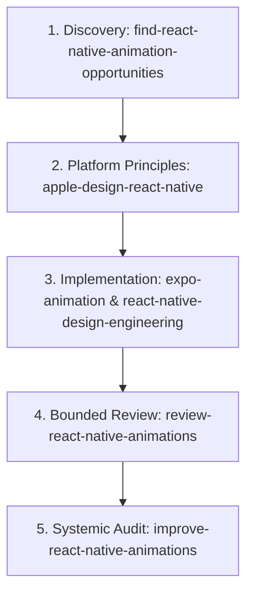

# Eparly Mobile Motion Design Skill System: Setup & Workflow Manual

This document details the architecture, configuration, and practical usage of the premium mobile motion design skills ecosystem configured for **Google Antigravity** on the **Eparly** codebase.

The goal of this system is to enable Antigravity to design, implement, review, and refine high-craft, native-feeling animations and micro-interactions in React Native and Expo applications—strictly adhering to Eparly's approved editorial visual directions.

---

## 1. Installed Motion Skills Inventory

| Skill Identifier | Source Repository | Scope | Primary Responsibility |
|:---|:---|:---:|:---|
| **`eparly-motion-director`** | Project Custom Orchestration | Project & Global | Motion conductor: enforces Eparly's restrained motion philosophy, motion tokens, editorial design preservation, and cross-skill delegation. |
| **`expo-animation`** | [`expo/skills`](https://github.com/expo/skills) (Emil Kowalski) | Global & Project | Native Expo implementation: Reanimated 4 worklets, Gesture Handler, UI-runtime execution, spring physics, and interruptibility. |
| **`react-native-design-engineering`** | [`zhanziyang/react-native-design-skills`](https://github.com/zhanziyang/react-native-design-skills) | Global & Project | Component-level motion craft: micro-interactions, press feedback, sheet transitions, card expansion, and tactile polish. |
| **`apple-design-react-native`** | [`zhanziyang/react-native-design-skills`](https://github.com/zhanziyang/react-native-design-skills) | Global & Project | Apple HIG fluid interaction principles: direct manipulation, momentum, snap points, depth layering, and subtle multimodal feedback. |
| **`find-react-native-animation-opportunities`** | [`zhanziyang/react-native-design-skills`](https://github.com/zhanziyang/react-native-design-skills) | Global & Project | Read-only discovery: scans screens to identify where motion clarifies state transitions or user actions without adding friction. |
| **`review-react-native-animations`** | [`zhanziyang/react-native-design-skills`](https://github.com/zhanziyang/react-native-design-skills) | Global & Project | Bounded review: evaluates specific animations, verifying UI-thread execution, accessibility, and thread safety against code evidence. |
| **`improve-react-native-animations`** | [`zhanziyang/react-native-design-skills`](https://github.com/zhanziyang/react-native-design-skills) | Global & Project | Systemic audit: audits multi-file or project-wide motion systems, establishing prioritized roadmaps and unified animation tokens. |
| **`react-native-animation-vocabulary`** | [`zhanziyang/react-native-design-skills`](https://github.com/zhanziyang/react-native-design-skills) | Global & Project | Interaction lexicon: reverse lookup from plain-language motion descriptions to standard native animation terminology. |

---

## 2. Filesystem Locations

To ensure global reusability across projects while supporting project-specific rules, skills are deployed in the following locations:

1. **Antigravity App / IDE Global Scope**:
   - `~/.gemini/config/skills/<skill-name>/`
   - Explicitly indexed via `~/.gemini/config/skills.json`
2. **Antigravity CLI Global Scope**:
   - `~/.gemini/antigravity-cli/skills/<skill-name>/`
3. **Universal Agent Scope**:
   - `~/.agents/skills/<skill-name>/`
4. **Eparly Workspace Scope**:
   - `/Users/salah-eddinerami/Documents/eparly/.agents/skills/<skill-name>/`
   - Orchestration rules: `.agents/rules/ui-ux-orchestration.md`

---

## 3. How the Motion Skills Work Together

The ecosystem operates as a disciplined, staged pipeline managed by the `eparly-motion-director`:



### Delegation Strategy
- **When exploring new motion**: Activate `find-react-native-animation-opportunities` to produce a read-only list of high-value touchpoints. The skill acts as an aggressive filter, rejecting unnecessary animations.
- **When establishing physical behavior**: Activate `apple-design-react-native` to specify spring dynamics, damping ratios, gesture handoffs, and haptic tiers.
- **When writing code**: Use `expo-animation` as the primary construction guide for Reanimated 4 and Gesture Handler 3 on Expo SDK 58, paired with `react-native-design-engineering` for component-level polish.
- **When checking work**: Run `review-react-native-animations` on diffs to verify frame rates, worklet execution, and reduced-motion handling.

---

## 4. Eparly Motion Philosophy & Tokens

Eparly is a high-trust financial application. Motion must preserve user agency and reinforce clarity.

### Approved Visual Directions Preserved
Animations must complement Eparly's established visual identity:
1. **Quiet Monograph**: Minimalist, generous negative space, high typographic contrast.
2. **Editorial Financial Overview**: Bold balance headlines, structured tabular hierarchy.
3. **Editorial Breakdown**: Geometric category allocation, elegant progress fills.
4. **Editorial Transaction Journal**: Monospace currency figures, crisp divider rhythm.

*Rule: Never modify colors, typography, or spatial structure under the guise of an animation update.*

### Reusable Motion Tokens

| Interaction Category | Duration | Damping / Stiffness | Intended Application |
|:---|:---:|:---|:---|
| **Press Feedback** | 100–150ms | `damping: 18, stiffness: 220` | Button press scale (0.97–0.98), card tap, list row touch down. |
| **Small State Transitions** | 150–220ms | `damping: 20, stiffness: 180` | Segmented tab switch, filter pill toggle, checkbox check. |
| **Content & Layout Shifts** | 180–280ms | `damping: 24, stiffness: 160` | Accordion reveal, card dismiss, sheet drag, transaction expand. |
| **Chart & Data Transitions** | 200–300ms | Smooth ease-out curve | Bar height adjustments, donut arc fills, category re-balances. |
| **Modal & Sheet Drag** | 250–350ms | Apple sheet spring curve | Bottom sheet drag-to-dismiss, modal presentation. |

---

## 5. How to Invoke Motion Skills

### 1. Motion Opportunity Discovery
```text
Act as eparly-motion-director and run find-react-native-animation-opportunities on 
apps/mobile/src/components/dashboard/spending-chart.tsx.
Evaluate where subtle motion would clarify data changes without adding visual noise.
```

### 2. Micro-Interaction Engineering
```text
Using expo-animation and react-native-design-engineering, implement fluid press feedback 
for our quick-actions-section buttons.
Ensure animations run on the Reanimated UI thread and include subtle haptic feedback.
```

### 3. Apple-Style Gesture Physics
```text
Using apple-design-react-native, review the swipe-to-dismiss gesture physics on our 
transaction list items. Recommend appropriate spring damping and velocity snap points.
```

### 4. Animation Code Review
```text
Run review-react-native-animations on our recent dashboard animation pull request.
Verify whether animations are interruptible, thread-safe, and honor reduced-motion settings.
```

---

## 6. Maintenance & Updates

### Updating Skills via Skills CLI
```bash
# Update all global skills
npx -y skills update -g

# Or update specific motion packages
npx -y skills add expo/skills --skill expo-animation -g -y
npx -y skills add zhanziyang/react-native-design-skills \
  --skill react-native-design-engineering \
  --skill find-react-native-animation-opportunities \
  --skill review-react-native-animations \
  --skill improve-react-native-animations \
  --skill apple-design-react-native \
  --skill react-native-animation-vocabulary \
  -g -y
```

### Synchronizing Upstream Changes to Antigravity
After updating skills in `~/.agents/skills/`, sync to Antigravity global config:
```bash
cp -R ~/.agents/skills/* ~/.gemini/config/skills/
cp -R ~/.agents/skills/* ~/.gemini/antigravity-cli/skills/
cp -R ~/.agents/skills/* .agents/skills/
```

---

## 7. Troubleshooting & Verification

### Issue: A skill is not recognized in active conversation
1. **Verify Path**: Check that `~/.gemini/config/skills/<skill-name>/SKILL.md` exists.
2. **Verify Frontmatter**: Confirm the YAML frontmatter contains lowercase `name:` matching the directory name.
3. **Session Refresh**: Reload the Antigravity IDE window (`Developer: Reload Window`) or launch a new chat turn so Antigravity re-reads its skill registry.

### Technical Guardrails
- **No Web / DOM Libraries**: Never use Framer Motion, CSS `@keyframes`, or DOM APIs in React Native code.
- **Always Honor Reduced Motion**: Check `useReducedMotion()` from `react-native-reanimated` or `AccessibilityInfo.isReduceMotionEnabled()`.
- **Zero Financial Discrepancies**: Never animate numbers in a way that flashes false amounts or misaligns currency units.

